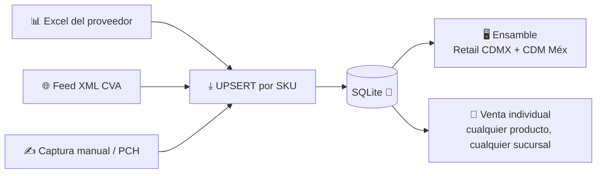
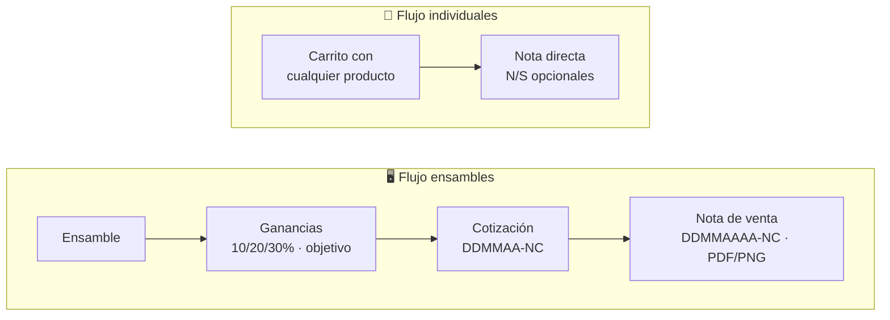

<div align="center">


# ⚙️ Generador de Presupuestos

**Cotiza, arma y vende equipos de cómputo — con inventario multi-proveedor en tiempo real.**


Aplicación de escritorio para cotizar y vender computadoras armadas **y
productos individuales**, con inventario multi-proveedor (arroba y CVA),
cálculo de ganancias, notas de venta exportables a PDF/PNG y base de datos
SQLite normalizada.

</div>

---

## 🚀 Compilar y ejecutar

| Requisito | Nota |
|---|---|
| [Rust](https://rustup.rs) | canal estable |
| [Node.js](https://nodejs.org) 18+ | |
| [LibreOffice](https://www.libreoffice.org) | solo para listas `.xls` (conversión interna) |

```bash
npm install
npm run tauri dev     # desarrollo
npm run tauri build   # producción (.app / .dmg / .msi según tu SO)
```

## 📥 Primera corrida (importante)

La aplicación **no incluye catálogo de productos**: cada instalación genera
el suyo desde el Excel de su proveedor. Dos caminos:

### Opción A — Importar Excel directo ✅ (recomendada)

1. Abre la app → pestaña **Ajustes**.
2. Botón **"⤒ Importar Excel del proveedor (.xlsx)"** y elige la lista.
3. La app detecta el formato por sus encabezados (CVA, arroba o genérico)
   y hace UPSERT por SKU.

Para actualizar precios después, simplemente importa la lista nueva: los
productos existentes se actualizan (conservando su identidad) y los nuevos
se agregan. No hace falta recompilar. Al terminar, la app muestra un
**informe de existencias** con los componentes que quedaron agotados y
están vigentes en un preensamble o personalizado.

### Opción B — Semilla JSON (avanzada)

```bash
python3 scripts/extract_catalog.py "ruta/a/lista.xlsx"
# genera data/catalog_seed.json (ignorado por git)
```

La app la detecta automáticamente al arrancar (busca en el directorio de
datos, en los recursos del paquete y en `data/`).

> [!WARNING]
> **`data/catalog_seed.json` no se publica en el repositorio** porque
> contiene precios de proveedores. Si no existe, la app compila y arranca
> con catálogo vacío.

## 🏭 Proveedores (`src-tauri/src/suppliers.rs`)

Cada formato de lista es un **adaptador** (`SupplierAdapter`): nombre,
detección por firma de encabezados y valores por defecto. La lectura del
Excel (calamine), el mapeo de columnas por nombre (insensible a orden,
acentos y mayúsculas) y la clasificación de tipos son compartidos.

| Adaptador | Formato |
|---|---|
| `arroba` | Lista actual: departamento, moneda, promoción, almacenes A-CEN/AVE-2/CEDIS/CMAL/GDL y fila de T.C |
| `cva` | `.xls` o `.xlsx`: Clave, **Codigo de Fabricante** (SKU), Marca, Grupo, Precio, Moneda, Promos, **Disp** y **Disp CD**, UPC |
| `generico` | Fallback: SKU + descripción + costo; el tipo se infiere de la descripción |
| captura manual | Sin lista: alta a mano desde la app (Catálogo o el picker de ensambles), con existencia propia. Incluye al proveedor **PCH** |

Para agregar un proveedor nuevo: implementa `SupplierAdapter` con su
`detect()` y agrégalo a `adapters()` (específicos antes que genéricos).

### 🌐 Feed XML de CVA

`src-tauri/src/cva_feed.rs` consulta e importa directo del servicio XML de
CVA (`lista_precios.xml`). Configura tu **número de cliente** en
**Ajustes → Feed XML de CVA** y recuerda **dar de alta la IP** del equipo
en el portal de CVA. El servicio solo responde de **19:01 a 08:59** — fuera
de ese horario devuelve la lista vacía (la app lo avisa).

- **Importar grupos de ensamble**: los 11 grupos de interés con
  `sucursales=1&promos=1&subgpo=1`. Dentro de memorias y energía, lo que no
  es de ensamble (USB, flash, UPS…) se importa como tipo «otro» — vendible
  en venta individual, nunca en ensambles.
- **Precio efectivo = precio de promoción** cuando existe
  (`PrecioDescuento`); la promo queda registrada (descripción, vencimiento,
  unidades) en `offer_promos` como referencia.
- **Marcas canónicas**: «ASUS (OEM)» se importa como ASUS (se recorta lo
  que va entre paréntesis).
- Los importes **parciales no barren** existencias; el import **completo**
  (`grupo=%`, todas las categorías y marcas, para crear el catálogo entero)
  sí agota los SKU ausentes — disponible por comando, pensado para la
  ventana nocturna.

### 🗂️ Catálogos de atributos (Ajustes)

Marca, Socket, DDR, Factor de forma y Formato de memoria RAM son
**catálogos normalizados** (tablas `brands` y `spec_options`): los
formularios de alta usan listas desplegables, nunca texto libre, para
evitar problemas de normalización. Valores nuevos se agregan desde
**Ajustes → "Catálogos del producto"** (su propio menú, uno por catálogo).
Los imports de listas también registran automáticamente cualquier valor
nuevo que traigan.

## 📦 Inventario multi-proveedor



- El mismo SKU puede existir en varios proveedores con precio y
  existencias distintos (`product_offers`, clave `(sku, supplier)`).
- El catálogo muestra siempre el **menor precio disponible** con su
  procedencia (chip @ o CVA).
- **Inventario desglosado** por proveedor en la vista Catálogo.
- **Stock por flujo**:
  - Ensamble: arroba → CEN+AVE-2+CEDIS; CVA → **Disp** (feed XML: Retail
    CDMX + CDM México).
  - Venta individual: arroba → igual; CVA → **Disp + Disp CD** (feed XML:
    **cualquier sucursal**).
- **Venta individual = cualquier producto con existencias** 🛒 (cámaras,
  cables, memorias USB…): la búsqueda incluye los tipo «otro» y tiene
  **filtro por marca** además del texto (SKU, modelo, descripción o marca).
- Los artículos **solo-CD** (CVA) van bloqueados en el picker de ensambles
  con la marca "SOLO CD · no ensamble".

<details>
<summary><b>🔒 Existencias, edición y correcciones protegidas</b></summary>

- **Sin existencia no se ensambla**: el picker bloquea los agotados
  ("SIN EXISTENCIA"), el botón `+` de cantidad no pasa del disponible y un
  renglón que pide más de lo que hay es **error de validación**
  (`out_of_stock`) — el ensamble no se puede confirmar ni vender hasta
  corregirlo. Reducir o quitar siempre se permite.
- **SKU ausente del Excel**: si un SKU que estaba en la lista de arroba o
  CVA ya no viene en la lista nueva, se interpreta como **agotado** — su
  oferta conserva el último precio conocido pero su existencia queda en 0
  (la genérica puede ser parcial y no barre).
- **Edición del catálogo**: botón ✎ por renglón. El maestro (descripción,
  marca, tipo, condición, specs) se edita siempre. Precio y existencia se
  corrigen por oferta: manual/PCH se escriben directo; en ofertas de lista
  (arroba/cva) quedan como **corrección protegida del import** — útil
  cuando el Excel trae datos incompletos (p. ej. CVA). Con varias ofertas
  se elige cuál editar; "↺ usar lista" revierte al valor importado. Solo
  se protege lo que difiere del valor vigente: si se guarda igual a la
  lista, la próxima importación vuelve a mandar.
- **Correcciones protegidas del import**: al editar el tipo o las specs de
  un SKU de lista (p. ej. marcar que un gabinete sí/no incluye fuente), el
  cambio vive en `overrides` y **ningún import lo pisa**. Solo se protegen
  las claves que difieren de la lista (🔒); el botón "usar lista" regresa
  al valor original y desprotege la clave.
- **Informe post-import**: al importar un Excel se listan los componentes
  sin existencia suficiente en ensambles vigentes, marcando los que se
  acaban de agotar y en qué cotizaciones (preensamble/personalizado) se
  usan.
- **Captura PCH sobre un SKU existente**: registra/actualiza únicamente la
  oferta PCH (precio y existencia) sin tocar el maestro — el alta manual
  genérica sobre un SKU existente se rechaza.
- En el picker puedes **ver los precios de los demás proveedores** y
  cambiar de proveedor en cualquier partida sin importar quién sea el más
  barato.
- **Alta desde el picker**: cada lista desplegable tiene el botón
  "＋ Agregar [slot] nuevo" para capturar un producto al instante y
  usarlo de inmediato (útil para proveedores sin Excel como PCH).
- **Advertencia PCH en fabricación**: al marcar "En fabricación" un
  ensamble que contiene productos de PCH aparece un banner con cada uno
  (descripción y SKU) pidiendo verificar existencia manualmente.

</details>

## ⚖️ Reglas de negocio



- **Tipo de cambio**: USD→MXP con el T.C **redondeado hacia arriba al
  entero** (18.52 → 19). El T.C de referencia es siempre **el más elevado**
  entre las listas importadas.
- **Costo del ensamble**: precios a MXN, suma (subtotal), IVA 16% —
  subtotal + IVA = total, en vivo.
- **Ganancias**: presets 10/20/30% o % libre por componente. Precio
  objetivo: la diferencia se reparte equitativamente ajustando la ganancia
  y el IVA se recalcula — Subtotal + IVA = Total siempre coincide.
- **Validación de ensamble**: mínimos por slot, compatibilidad de socket
  CPU↔MOBO, DDR RAM↔MOBO y factor de forma gabinete↔MOBO (si faltan datos
  del gabinete se marca advertencia para revisión manual). SODIMM
  excluida de ensambles. Renglones con más cantidad que la existencia
  disponible: error `out_of_stock` (bloquea confirmar y nota de venta).
- **Cotizaciones**: número DDMMAA-NC consecutivo por día; tipos
  **preensamble** (caduca el día 1 del mes siguiente; si se genera el
  último día del mes, 15 días naturales) y **personalizado** (15 días
  naturales). Estados: vigente, en fabricación (no caduca) y caducada (no
  genera nota de venta).
- **Notas de venta**: número propio DDMMAAAA-NC, ligadas a su cotización
  con precios coincidentes; un renglón por unidad con su número de serie;
  exportación a PDF y PNG con tipografía única monospace.
- **Títulos con IA** (opcional): guarda tu clave API de Z.ai en Ajustes y
  normaliza los títulos del catálogo en lotes de 100. Los ya normalizados
  quedan excluidos de las corridas siguientes.

## 🗂️ Estructura

```
src-tauri/src/
├── db.rs           SQLite (v10): maestro + ofertas + existencias 3FN/BCNF,
│                   overrides manuales y promos protegidos del import
├── cva_feed.rs     Consultas e importación al feed XML de CVA
├── domain/         Dominio puro: componente, dinero, ensamble, costo,
│                   ganancias, carrito, notas de venta
├── suppliers.rs    Importación de Excel por proveedor (calamine)
├── catalog/        Catálogo en memoria (mejor oferta por SKU)
├── store.rs        Estado de la app y persistencia
├── commands.rs     Comandos Tauri (frontera hacia la GUI)
├── ai.rs           Normalización de títulos con Z.ai
└── lib.rs          Composición

src/                GUI (TypeScript + Vite, sin framework)
docs/esquema.mmd    Diagrama de la base (Mermaid)
scripts/            extract_catalog.py (semilla JSON opcional)
```

## 🧪 Tests

```bash
cd src-tauri
cargo test
```

Los fixtures de prueba (`tests/fixtures/`) contienen **datos sintéticos**;
las listas reales de proveedores no se publican en el repositorio.

## 💾 Persistencia

SQLite en modo WAL: `presupuestos.db` en el directorio de datos de la app
(macOS: `~/Library/Application Support/com.harunoyukki.generador-presupuestos/`).
Migraciones automáticas con control de versión (`PRAGMA user_version`).

## Licencia

Pendiente de definir.
